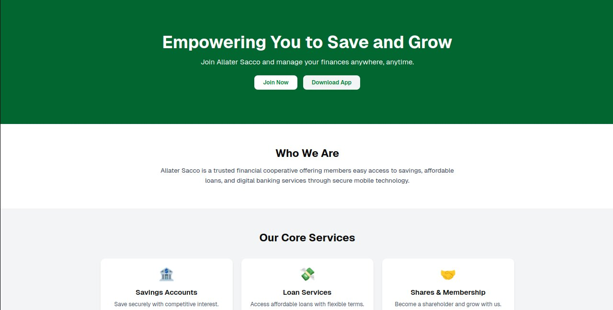
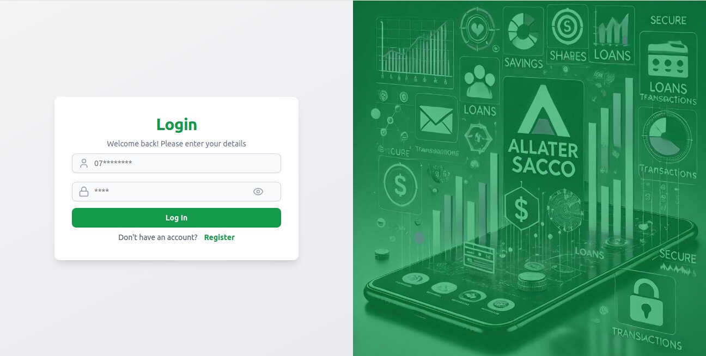
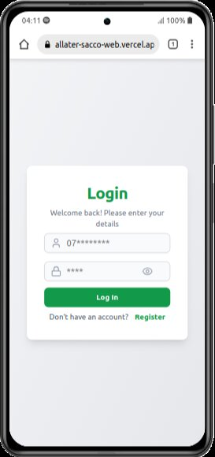
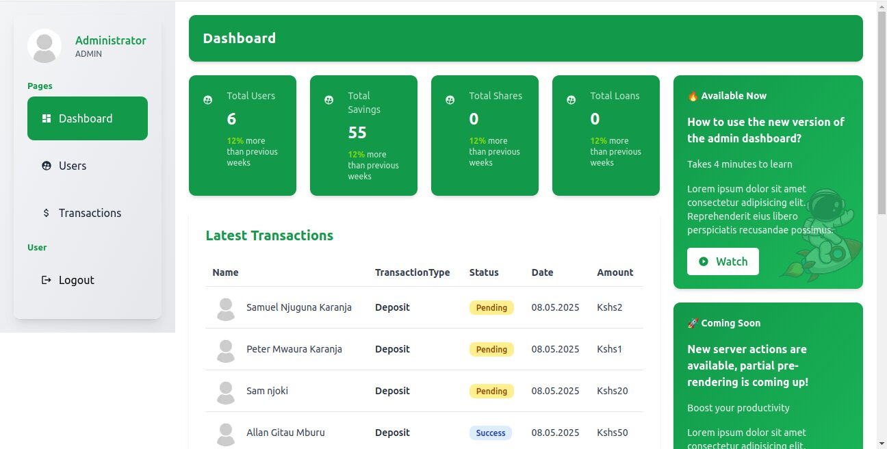
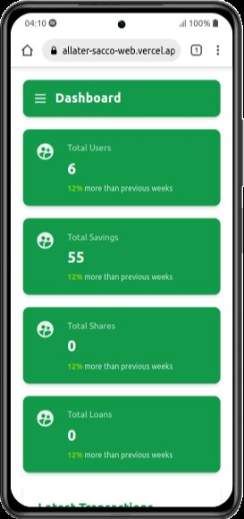
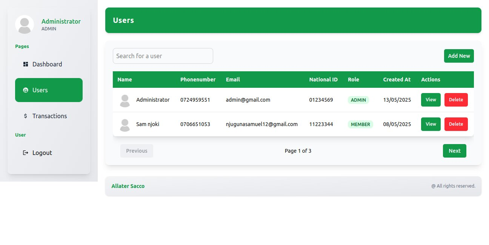
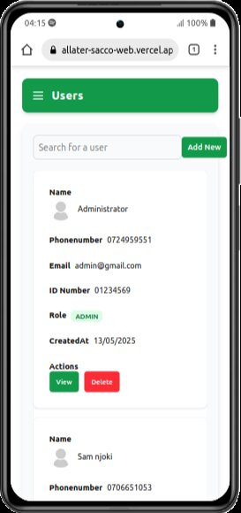
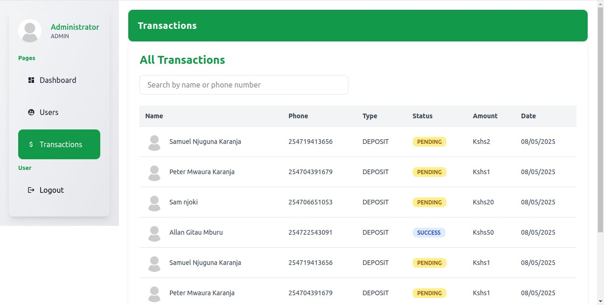
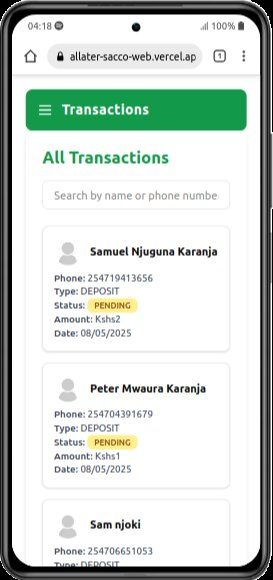

## 🛠️ Getting Started

Follow these steps to set up the project locally.

### Prerequisites

Make sure you have the following installed:

-   [Node.js](https://nodejs.org/) (v16 or higher recommended)
-   [Yarn](https://classic.yarnpkg.com/en/docs/install) or [npm](https://www.npmjs.com/)

### Installation

1. **Clone the repository**

```bash
git clone https://github.com/your-username/allater-sacco-web.git
cd allater-sacco-web
```

2. **Install dependencies**

```bash
yarn install
# or
npm install
```

3. **Configure environment variables**

Create a `.env.local` file in the root directory and add the following:

```env
NEXT_PUBLIC_API_BASE_URL=https://allater-sacco-backend.onrender.com

# ⚠️ Note:
# For demo purposes, screenshots are included below.
# If you are a recruiter or reviewer and would like access to a live demo or test credentials,
# feel free to use the following:
#
# Phone Number: 0724959551
# Password: 4332
```

4. **Run the development server**

```bash
yarn dev
# or
npm run dev
```

## 📸 Screenshots

Here are some screenshots showcasing the Sacco Website Frontend:

### Homepage



Mobile View:


### Login Page



Mobile View:



### Dashboard Page



Mobile View:



### Dashboard/Users Page



Mobile View:



### Dashboard/Transactions Page



Mobile View:


